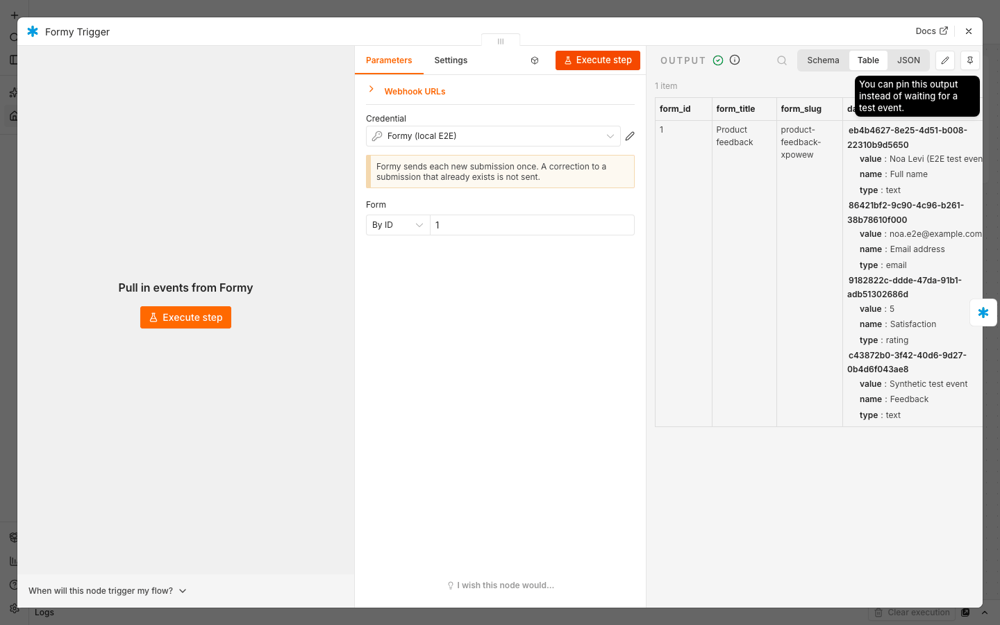
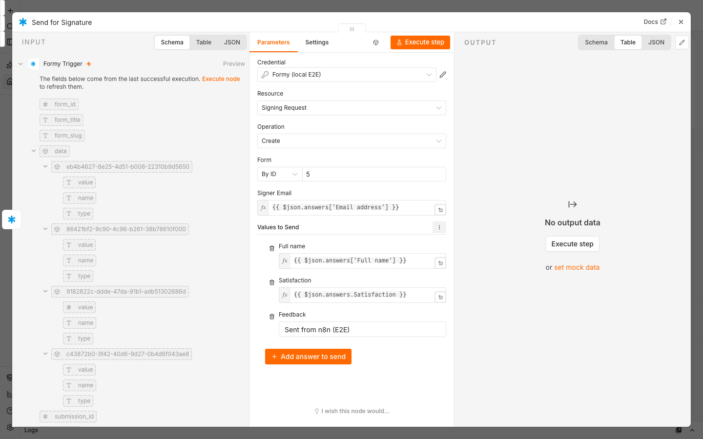

# n8n-nodes-formy

n8n community nodes for [Formy](https://formy.co.il), the Hebrew-first online form builder for
Israeli businesses, with electronic signatures inside the form and documents sent out for signature.

- **Formy Trigger** starts a workflow when a Formy form receives a new submission.
- **Formy** lists workspaces, forms and form fields, and sends a document for signature with
  answers already filled in.

[Installation](#installation) · [Credentials](#credentials) · [Formy Trigger](#formy-trigger) ·
[Formy](#formy) · [Example workflow](#example-workflow) · [Errors](#errors) ·
[Compatibility](#compatibility) · [Development](#development) · [Releasing](#releasing)

## Installation

**Self-hosted n8n:** go to **Settings › Community Nodes › Install**, enter `n8n-nodes-formy`, and
confirm. See n8n's [community node installation guide](https://docs.n8n.io/integrations/community-nodes/installation-and-management/gui-installation/).

**n8n Cloud:** n8n Cloud installs only community nodes that n8n has verified. Once this package
is verified, search for **Formy** in the nodes panel.

## Credentials

The nodes use one credential, **Formy API**.

1. In Formy, open **Settings › API** and create a token
   ([step by step](https://formy.co.il/developers/api#tokens)). A token acts as the person who
   created it, in that person's workspaces only.
2. Give it these abilities (a new token has all of them unless you untick some):

   | Ability | Needed by |
   | --- | --- |
   | `workspaces-read` | The workspace and form lists |
   | `forms-read` | Forms, form fields, and reading a form's current version before a signing request |
   | `manage-integrations` | Formy Trigger |
   | `forms-write` | Signing Request › Create |

3. In n8n, create a **Formy API** credential and paste the token into **API Token**. Keep
   **Base URL** at `https://formy.co.il/api`.

The credential test calls `GET /external/validate`, which accepts any valid token. A token that
is missing an ability passes the test and fails later, in the step that needs the ability.

## Formy Trigger

Starts the workflow when the chosen **Form** receives a new submission.

- **Activating the workflow** subscribes it in Formy, and **deactivating** it unsubscribes it.
  Testing the trigger in the editor (**Execute step**) subscribes n8n's test URL until the test
  event arrives, then unsubscribes it.
- The subscription is an **n8n** connection on the form's **Integrations** tab in Formy, where it
  can be paused or deleted, and where its delivery history is kept. Its menu links back to the
  workflow.
- Formy sends each new submission **once**, with a 10-second timeout, and does not retry.
  A correction to a submission that already exists (an edit link, or an owner's fix) is **not**
  sent. A respondent sending a form that updates the record it matches is a new submission, and
  is sent.
- Formy sends only to a **public HTTPS** address. On a self-hosted n8n behind a proxy, set
  `N8N_WEBHOOK_URL` (`WEBHOOK_URL` on older versions) to the instance's public HTTPS address, or
  activating the workflow fails with "Formy only sends submissions to a public HTTPS address".

The output is Formy's delivery, plus `answers`:

```json
{
  "form_id": 12,
  "form_title": "Service agreement",
  "form_slug": "service-agreement",
  "submission_id": 345,
  "data": {
    "3f6c2a1e-8b4d-4c2f-9a71-1d2e3f4a5b6c": { "value": "Dana Cohen", "name": "Full name", "type": "text" },
    "8a1d4e2b-5c3f-4a6e-b7d8-9e0f1a2b3c4d": { "value": "dana@example.com", "name": "Email", "type": "email" }
  },
  "answers": {
    "Full name": "Dana Cohen",
    "Email": "dana@example.com"
  }
}
```

- `data` keys each answer by field ID, with the field's name and type. Formy also adds
  `edit_link`, `attribution` and `pdf_url` (and `pdf_base64`) when the form has them; see
  [the webhook payload](https://formy.co.il/developers/webhooks#payload).
- `answers` is added by this node: the same answers keyed by field name, in the form's order.
  If two fields share a name, the second is keyed `"<name> (<field ID>)"`. Field names change
  when someone renames a field, so a mapping that must survive renames should use
  `data["<field ID>"].value`.



## Formy

| Resource | Operation | What it does |
| --- | --- | --- |
| Workspace | Get Many | The workspaces the token's owner belongs to |
| Form | Get Many | The forms in one workspace, each with its ID, title, slug, visibility and public URL |
| Form | Get Fields | A form's fields: ID, name, type, and whether it is required or hidden. Layout blocks are left out |
| Signing Request | Create | Sends a form to one person for signature, with answers already filled in |

**Signing Request › Create**

- **Form** must have a signing round whose step takes its recipient from an email field. Formy
  writes **Signer Email** into that field and emails the signer a link.
- **Prefilled Answers** lists the form's fields. Add the ones to fill in. The signer sees them
  filled in and cannot change them; the fields you leave out are for the signer. Uploads,
  signatures, payments, passwords, calculations, grids, repeatable groups and scanner fields are
  not offered.
- Before sending, the node reads the form's current version. If someone saves the form in
  between, Formy refuses with "The form changed in Formy while the document was being sent, so
  nothing was sent", and nothing is sent; run the step again.
- A document sent this way counts against the workspace's signed-document allowance exactly as
  one sent from Formy does, and Formy limits how many signing invitations a workspace sends in an
  hour.
- The output is the new submission: its `id`, `status`, `form_slug`, `email` and the `data` it
  holds.



## Example workflow

[`examples/new-submission-to-signing-request.json`](examples/new-submission-to-signing-request.json)
sends a contract for signature whenever someone fills in a lead form. Import it in n8n
(**Workflows › Import from File**), then:

1. Choose the **Formy API** credential on both nodes.
2. In **Formy Trigger**, choose the lead form.
3. In **Send for Signature**, choose the contract form, check that **Signer Email** points at the
   lead form's email answer (the example reads `answers.Email`), and add the answers the contract
   should open with, for example **Full name** ← `{{ $json.answers['Full name'] }}`.
4. Activate the workflow and submit the lead form once.

## Errors

Formy's API answers in Hebrew, so the nodes explain every refusal in English from its status and
code instead of passing Formy's message through.

| Message | What to do |
| --- | --- |
| Formy did not accept the API token | Check the token, or create a new one in Formy under Settings › API |
| The API token is not allowed to do this | Give the token the abilities above. A read-only workspace member cannot change forms |
| Formy could not find this form, or the token cannot see it | Check the form, and that the token's owner is a member of its workspace |
| Formy only sends submissions to a public HTTPS address | Make n8n's webhook URLs public HTTPS (see [Formy Trigger](#formy-trigger)) |
| This form has no signing round, so there is nobody to send the document to | Add a signing step whose recipient comes from an email field |
| A step of the form's signing round has no address to send to | Give every signing step a recipient |
| A prefilled answer names a field that is not on this form, or holds a value the document cannot show | Remove the answer or change its value |
| The form changed in Formy while the document was being sent, so nothing was sent | Run the step again |
| This Formy workspace has used up its signed-document allowance | Upgrade the plan or wait for the allowance to renew |
| The workspace reached its hourly limit of signing invitations | Try again when the error says |
| Too many requests to Formy | Formy accepts 60 automation requests a minute per user |
| Formy is not responding as expected | Try again in a few minutes, or contact support@formy.co.il |

## Compatibility

Built with `@n8n/node-cli` and tested on n8n 2.43.7. The package has no run-time dependencies.

## Development

```bash
npm ci
npm run lint     # n8n's community node linter (n8n-node lint)
npm run build    # n8n-node build
npm test         # unit tests (vitest)
npm run scan     # the lint half of n8n's verification scan, on the source and the packed tarball
npm run dev      # n8n with this package loaded, on http://localhost:5678
```

The unit tests mock every request to Formy. Inside the Formy repository,
`test/api-contract.test.mts` also checks the routes and refusal codes the nodes rely on against the
API's source; in a copy of this package on its own, those checks are skipped.

## Releasing

Releases are published to npm by GitHub Actions with an
[npm provenance statement](https://docs.npmjs.com/generating-provenance-statements), which n8n
requires for verified community nodes (`.github/workflows/publish.yml`):

1. Update `version` in `package.json` and add the version to `CHANGELOG.md`.
2. Commit, then tag the commit with the version and push both:
   `git tag 0.1.1 && git push origin main 0.1.1`.

The workflow checks that the tag matches `package.json`, runs the tests and the scan, then
`npm run release`, which lints, builds and publishes with provenance.

## Resources

- [Formy developer documentation](https://formy.co.il/developers/automation)
- [n8n community nodes documentation](https://docs.n8n.io/integrations/community-nodes/)
- Support: support@formy.co.il

## License

[MIT](LICENSE.md)
